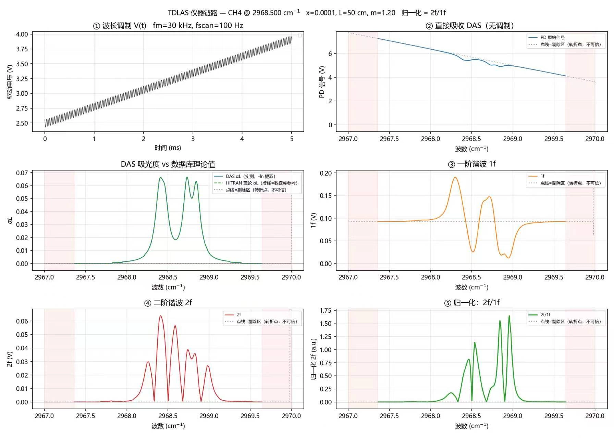

<div align="center">

<h1>SpectroLink</h1>

<p><b>多技术光谱传感仿真 MCP</b><br>
TDLAS-WMS · LITES · NDIR · CRDS · FTIR · DOAS<br>
7 技术 · 6 server · 45 工具 · 本地 stdio · 无需 API key</p>

<a href="https://github.com/LKF0402/spectrolink/releases"></a>
<a href="https://github.com/LKF0402/spectrolink/stargazers"></a>
<a href="LICENSE"></a>


</div>

> **一句话**：把气体、波段、工况告诉 AI，它直接给你仪器级波形、谱图和检测限。全程本地，不用 API key。

## 🚀 30 秒上手

**把下面整段复制给 AI**：

```text
请帮我把 SpectroLink 装好并跑通，不要让我手动改路径：
1. 检查 Python ≥ 3.10；git clone https://github.com/LKF0402/spectrolink.git 到固定目录。
2. 在该目录执行 pip install -r requirements.txt 和 pip install -e ./spectrolink_core。
3. 在我的 MCP 客户端里只启用 spectrolink-tdlas：command 用本机 python 绝对路径，args 用该目录下 server-tdlas/tools/tdlas_mcp.py。
4. 把仓库根目录的 SKILL.md 安装为 Skill。
5. 运行 python server-tdlas/tools/tdlas_mcp.py --selftest，然后告诉我：装在哪、改了哪个配置、接下来三句可以怎么说。
任何一步失败就停下来报告，不要跳过。
```

装好后直接说人话：

- `画一个 CH4 @ 2968.5 cm-1 的 WMS 图，50 ppm，10 cm`
- `算一下这个系统的 LOD`
- `画 10、50、100 ppm 的 WMS 对比`

参数不全时 AI 会问，回答即可。

## 🧪 免标定（TDLAS / LITES）

**零基线 + 一个绝对锚点 + 工况，替掉整条浓度标定曲线。**

- TDLAS：`shape` 看波形；有 I0 走 `absolute`；有已知浓度参考走 `anchored`
- LITES：`anchored`，单点参考 + 功率/共振归一化
- 数据清单与 CSV 列名：[docs/CALIB_FREE.md](./docs/CALIB_FREE.md)

## 📊 输出长这样



> CH4 @ 2968.5 cm-1：驱动电压 → DAS 吸收 → 1f → 2f → 2f/1f；红色为电压折返剔除区。

## 📖 文档

| 想干什么 | 看哪里 |
|---|---|
| 学怎么跟 AI 说话 | [USAGE.md](./USAGE.md) |
| 做免标定 | [docs/CALIB_FREE.md](./docs/CALIB_FREE.md) |
| 查物理模型与参数 | [TECHNICAL.md](./TECHNICAL.md)（开发者参考） |
| 查校验判据与边界 | [docs/VALIDATION.md](./docs/VALIDATION.md)（开发者参考） |

## ⚠️ 声明

- 输出是**理论仿真**，用于研究参考、方法验证与系统选型；不能冒充实验测量。
- GPLv3 开源；衍生作品须保留版权声明并同样开源。

引用：`The instrument-level spectral simulations were performed using SpectroLink (https://github.com/LKF0402/spectrolink, GPLv3).`

底层数据：HAPI (Kochanov et al., JQSRT 2016) · HITRAN2024 (Gordon et al., JQSRT 2026)。

Star 或转发，就是对这个个人开源项目最直接的支持。
